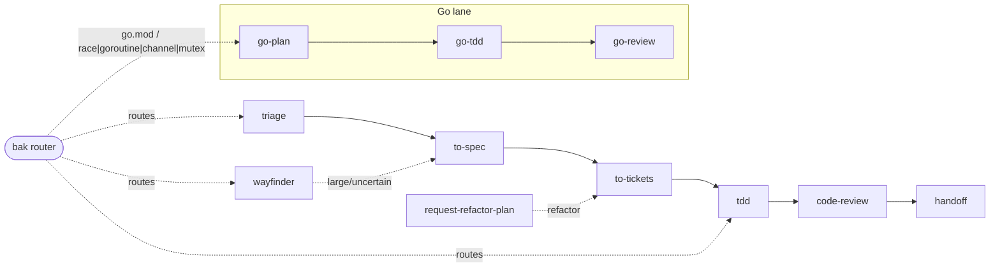

# BAK — bad-agent-kit

> **BAK** (Batman Agents Kit) — a curated skills marketplace + workflow
> orchestrator. Compose, never own.
> *bad-agent-kit* is the persona: the punchline encodes the rules —
> don't ship the bad agent kit. Never mutate on inspect. Never publish without
> authority. Route every task through the smallest complete set of skills.

[](https://skills.sh)
[](https://www.npmjs.com/package/bad-agent-kit)
[](https://pi.dev/packages)
[](https://github.com/aniqaqill/bad-agent-kit/actions)
[](LICENSE)

## What is this?

Two things, one repo:

1. **Marketplace** — a curated catalog of battle-tested agent skills. The
   catalog below is the catalog of record: every entry pins a source, an
   install command, and its position in the BAK workflow.
2. **Orchestrator** — the BAK router skill (`bak`) plus documented playbooks
   encoding how the skills chain together in real work: triage → spec →
   tickets → TDD → review → handoff.

BAK never forks upstream. Skills stay owned by their authors (primarily the
[Matt Pocock skills](https://github.com/mattpocock/skills) stack); BAK pins
them, composes them, and documents the chains.

## Install

```bash
# pi
pi install npm:bad-agent-kit

# Claude Code / Codex / Cursor via skills.sh
npx skills@latest add aniqaqill/bad-agent-kit -g --skill bak --agent cursor -y
```

⚠️ Pick ONE channel per agent. Installing through two channels on the same
agent duplicates every skill and drifts hashes silently.

## The catalog

| `bak` | this repo | `pi install npm:bad-agent-kit` | router — start of every task |
| `go-plan` | this repo | `pi install npm:bad-agent-kit` | Go plan phase — grill then spec |
| `go-tdd` | this repo | `pi install npm:bad-agent-kit` | Go implement — sensor gates + e2e tests |
| `go-review` | this repo | `pi install npm:bad-agent-kit` | Go review — standards + spec lenses |
| `chief` (legacy) | this repo | — | superseded by `bak`; kept for backlink resolution |
| `chrome-devtools` | [ChromeDevTools/chrome-devtools-mcp](https://github.com/ChromeDevTools/chrome-devtools-mcp) | `npx skills@latest add ChromeDevTools/chrome-devtools-mcp -g --skill chrome-devtools --agent cursor -y` | browser automation |
| `code-review` | [mattpocock/skills](https://github.com/mattpocock/skills) | `npx skills@latest add mattpocock/skills -g --skill code-review --agent cursor -y` | review before merge |
| `codebase-design` | [mattpocock/skills](https://github.com/mattpocock/skills) | `npx skills@latest add mattpocock/skills -g --skill codebase-design --agent cursor -y` | deep-module design |
| `diagnosing-bugs` | [mattpocock/skills](https://github.com/mattpocock/skills) | `npx skills@latest add mattpocock/skills -g --skill diagnosing-bugs --agent cursor -y` | diagnosis loop |
| `domain-modeling` | [mattpocock/skills](https://github.com/mattpocock/skills) | `npx skills@latest add mattpocock/skills -g --skill domain-modeling --agent cursor -y` | GLOSSARY/ADRs |
| `find-skills` | [vercel-labs/skills](https://github.com/vercel-labs/skills) | `npx skills@latest add vercel-labs/skills -g --skill find-skills --agent cursor -y` | discover capabilities |
| `grill-me` | [mattpocock/skills](https://github.com/mattpocock/skills) | `npx skills@latest add mattpocock/skills -g --skill grill-me --agent cursor -y` | get grilled |
| `grill-with-docs` | [mattpocock/skills](https://github.com/mattpocock/skills) | `npx skills@latest add mattpocock/skills -g --skill grill-with-docs --agent cursor -y` | grill with docs |
| `grilling` | [mattpocock/skills](https://github.com/mattpocock/skills) | `npx skills@latest add mattpocock/skills -g --skill grilling --agent cursor -y` | stress-test ideas |
| `handoff` | [mattpocock/skills](https://github.com/mattpocock/skills) | `npx skills@latest add mattpocock/skills -g --skill handoff --agent cursor -y` | hand over work |
| `implement` | [mattpocock/skills](https://github.com/mattpocock/skills) | `npx skills@latest add mattpocock/skills -g --skill implement --agent cursor -y` | direct implementation |
| `improve-codebase-architecture` | [mattpocock/skills](https://github.com/mattpocock/skills) | `npx skills@latest add mattpocock/skills -g --skill improve-codebase-architecture --agent cursor -y` | architecture passes |
| `migrate-to-shoehorn` | [mattpocock/skills](https://github.com/mattpocock/skills) | `npx skills@latest add mattpocock/skills -g --skill migrate-to-shoehorn --agent cursor -y` | test type safety |
| `prototype` | [mattpocock/skills](https://github.com/mattpocock/skills) | `npx skills@latest add mattpocock/skills -g --skill prototype --agent cursor -y` | throwaway design probes |
| `qa` | [mattpocock/skills](https://github.com/mattpocock/skills) | `npx skills@latest add mattpocock/skills -g --skill qa --agent cursor -y` | issue filing |
| `request-refactor-plan` | [mattpocock/skills](https://github.com/mattpocock/skills) | `npx skills@latest add mattpocock/skills -g --skill request-refactor-plan --agent cursor -y` | planned refactors |
| `research` | [mattpocock/skills](https://github.com/mattpocock/skills) | `npx skills@latest add mattpocock/skills -g --skill research --agent cursor -y` | primary-source research |
| `resolving-merge-conflicts` | [mattpocock/skills](https://github.com/mattpocock/skills) | `npx skills@latest add mattpocock/skills -g --skill resolving-merge-conflicts --agent cursor -y` | merge/rebase conflicts |
| `scaffold-exercises` | [mattpocock/skills](https://github.com/mattpocock/skills) | `npx skills@latest add mattpocock/skills -g --skill scaffold-exercises --agent cursor -y` | course scaffolding |
| `setup-matt-pocock-skills` | [mattpocock/skills](https://github.com/mattpocock/skills) | `npx skills@latest add mattpocock/skills -g --skill setup-matt-pocock-skills --agent cursor -y` | tracker setup |
| `tdd` | [mattpocock/skills](https://github.com/mattpocock/skills) | `npx skills@latest add mattpocock/skills -g --skill tdd --agent cursor -y` | build/test-first |
| `teach` | [mattpocock/skills](https://github.com/mattpocock/skills) | `npx skills@latest add mattpocock/skills -g --skill teach --agent cursor -y` | teach a topic |
| `to-spec` | [mattpocock/skills](https://github.com/mattpocock/skills) | `npx skills@latest add mattpocock/skills -g --skill to-spec --agent cursor -y` | synthesize plan |
| `to-tickets` | [mattpocock/skills](https://github.com/mattpocock/skills) | `npx skills@latest add mattpocock/skills -g --skill to-tickets --agent cursor -y` | split into tickets |
| `triage` | [mattpocock/skills](https://github.com/mattpocock/skills) | `npx skills@latest add mattpocock/skills -g --skill triage --agent cursor -y` | issue intake |
| `wayfinder` | [mattpocock/skills](https://github.com/mattpocock/skills) | `npx skills@latest add mattpocock/skills -g --skill wayfinder --agent cursor -y` | large/uncertain efforts |

Full pinned manifest: [`manifest/upstream-sources.txt`](manifest/upstream-sources.txt).
Playbooks: [`docs/playbooks/`](docs/playbooks/).

## The BAK workflow



## Repo layout

```text
skills/bak/            BAK router skill (pi package payload)
manifest/              pinned upstream sources — never vendored
docs/playbooks/        how the skills chain in real work
scripts/               bootstrap.sh / update.sh / scrub.sh
catalog/               catalog.json + generator (enabled past ~40 entries)
.github/               CI: privacy-scrub gate + catalog validation
```

## Contributing

Catalog edits go through `catalog/catalog.json` once it exists; until then the
README table IS the catalog — keep it in lockstep with
`manifest/upstream-sources.txt` (CI validates this). See
[CONTRIBUTING.md](CONTRIBUTING.md).

## License

MIT — skills listed here remain property of their respective authors.
