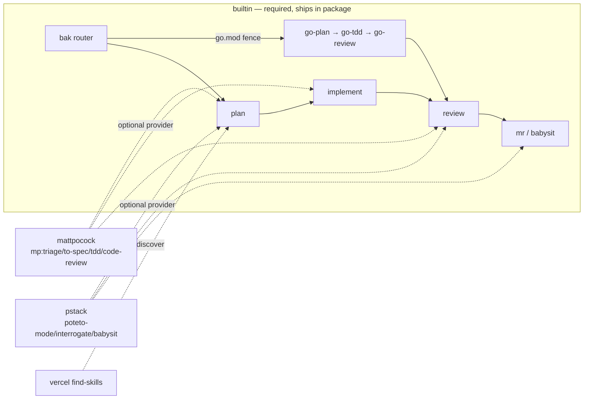
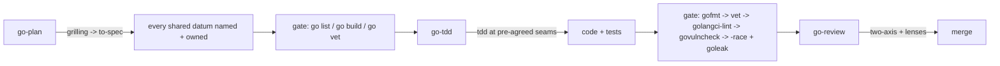

# 🦇 BAK — bad-agent-kit

> **BAK** (Bad-Agent Kit) — a curated skills marketplace + workflow
> orchestrator for coding agents. **Compose, never own.**
>
> *bad-agent-kit* is the persona: the punchline encodes the rules — don't ship
> the bad agent kit. Never mutate on inspect. Never publish without authority.
> Route every task through the smallest complete set of skills.

[](https://www.npmjs.com/package/bad-agent-kit)
[](https://pi.dev/packages)
[](https://skills.sh)
[](https://github.com/aniqaqill/bad-agent-kit/actions)
[](LICENSE)
[](CONTRIBUTING.md)

<sub>Tags: `golang` · `go` · `skills` · `marketplace` · `agent-skills` · `claude-code` · `codex` · `cursor` · `pi` · `mattpocock` · `pstack-inspired` · `workflow-orchestrator` · `tdd` · `code-review`</sub>

## Table of contents

- [What is this?](#what-is-this)
- [Install](#install)
- [The catalog](#the-catalog)
- [The BAK workflow](#the-bak-workflow)
- [Go-first skills](#go-first-skills)
- [Architecture](#architecture)
- [Repo layout](#repo-layout)
- [Contributing](#contributing)
- [Privacy & security](#privacy--security)
- [Acknowledgments](#acknowledgments)
- [License](#license)

## What is this?

Two things, one repo:

1. **Marketplace** — a curated catalog of battle-tested agent skills. The
   catalog below is the catalog of record: every entry pins a source, an
   install command, and its position in the BAK workflow. CI keeps the catalog
   in lockstep with the pinned manifest.
2. **Orchestrator** — the BAK router skill (`bak`) plus documented playbooks
   encoding the full SDLC: plan → implement → review → mr (babysitting to
   merge), with a Go-first lane (plan → tdd → review) with sensor gates at
   every phase exit, and a five-phase review pipeline with a builtin MR
   babysitter.

BAK never forks upstream. Skills stay owned by their authors; BAK pins them,
composes them, and documents the chains.

## Install

**BAK works with zero external suites** — the builtin lane (bak, go-plan,
go-tdd, go-review, babysit) is self-contained. Providers below are optional.

```bash
# pi — everything builtin
pi install npm:bad-agent-kit

# Claude Code / Codex / Cursor via skills.sh — builtin skills
npx skills@latest add aniqaqill/bad-agent-kit -g --skill bak --agent cursor -y
npx skills@latest add aniqaqill/bad-agent-kit -g --skill go-plan --agent cursor -y
npx skills@latest add aniqaqill/bad-agent-kit -g --skill go-tdd --agent cursor -y
npx skills@latest add aniqaqill/bad-agent-kit -g --skill go-review --agent cursor -y
npx skills@latest add aniqaqill/bad-agent-kit -g --skill babysit --agent cursor -y
```

Optional providers (pin them in `manifest/providers.toml`; detection proves
presence at session start):

| Provider | Channel | Install |
|---|---|---|
| mattpocock/skills | skills.sh / plugin | `npx skills@latest add mattpocock/skills -g --skill '*' --agent cursor -y --full-depth` |
| pstack | **plugin only** | `/add-plugin pstack` (Cursor) or `/plugin install pstack@cursor-plugins` |
| vercel-labs find-skills | skills.sh | `npx skills@latest add vercel-labs/skills -g --skill find-skills --agent cursor -y` |
| chrome-devtools | skills.sh + MCP | `npx skills@latest add chromedevtools/chrome-devtools-mcp -g --agent cursor -y` |

> ⚠️ **Pick ONE channel per agent per provider.** Two channels on one agent
> duplicate skills and drift hashes silently.

One-command bootstrap (detection-first, providers opt-in):

```bash
bash scripts/bootstrap.sh cursor --providers mattpocock,vercel-labs
```

## The catalog

| Skill | Source | Install | Workflow position |
|---|---|---|---|
| `bak` | this repo | `pi install npm:bad-agent-kit` | router — start of every task |
| `go-plan` | this repo | `pi install npm:bad-agent-kit` | Go plan — frontier interview + spec |
| `go-tdd` | this repo | `pi install npm:bad-agent-kit` | Go implement — sensor gates + e2e |
| `go-review` | this repo | `pi install npm:bad-agent-kit` | Go review — two-axis + lenses |
| `babysit` | this repo | `pi install npm:bad-agent-kit` | MR babysitter — builtin |
| `triage` | [mattpocock/skills](https://github.com/mattpocock/skills) | `npx skills@latest add mattpocock/skills -g --skill triage --agent cursor -y` | plan intake |
| `to-spec` | [mattpocock/skills](https://github.com/mattpocock/skills) | `npx skills@latest add mattpocock/skills -g --skill to-spec --agent cursor -y` | plan spec |
| `to-tickets` | [mattpocock/skills](https://github.com/mattpocock/skills) | `npx skills@latest add mattpocock/skills -g --skill to-tickets --agent cursor -y` | plan tickets |
| `tdd` | [mattpocock/skills](https://github.com/mattpocock/skills) | `npx skills@latest add mattpocock/skills -g --skill tdd --agent cursor -y` | implement (non-Go) |
| `code-review` | [mattpocock/skills](https://github.com/mattpocock/skills) | `npx skills@latest add mattpocock/skills -g --skill code-review --agent cursor -y` | review |
| `handoff` | [mattpocock/skills](https://github.com/mattpocock/skills) | `npx skills@latest add mattpocock/skills -g --skill handoff --agent cursor -y` | mr handoff |
| `grilling` | [mattpocock/skills](https://github.com/mattpocock/skills) | `npx skills@latest add mattpocock/skills -g --skill grilling --agent cursor -y` | plan stress-test |
| `wayfinder` | [mattpocock/skills](https://github.com/mattpocock/skills) | `npx skills@latest add mattpocock/skills -g --skill wayfinder --agent cursor -y` | large/uncertain |
| `setup-matt-pocock-skills` | [mattpocock/skills](https://github.com/mattpocock/skills) | `npx skills@latest add mattpocock/skills -g --skill setup-matt-pocock-skills --agent cursor -y` | suite setup |
| `research` | [mattpocock/skills](https://github.com/mattpocock/skills) | `npx skills@latest add mattpocock/skills -g --skill research --agent cursor -y` | docs research |
| `codebase-design` | [mattpocock/skills](https://github.com/mattpocock/skills) | `npx skills@latest add mattpocock/skills -g --skill codebase-design --agent cursor -y` | plan design |
| `diagnosing-bugs` | [mattpocock/skills](https://github.com/mattpocock/skills) | `npx skills@latest add mattpocock/skills -g --skill diagnosing-bugs --agent cursor -y` | diagnosis |
| `domain-modeling` | [mattpocock/skills](https://github.com/mattpocock/skills) | `npx skills@latest add mattpocock/skills -g --skill domain-modeling --agent cursor -y` | docs GLOSSARY/ADRs |
| `improve-codebase-architecture` | [mattpocock/skills](https://github.com/mattpocock/skills) | `npx skills@latest add mattpocock/skills -g --skill improve-codebase-architecture --agent cursor -y` | plan architecture |
| `prototype` | [mattpocock/skills](https://github.com/mattpocock/skills) | `npx skills@latest add mattpocock/skills -g --skill prototype --agent cursor -y` | plan probes |
| `grill-with-docs` | [mattpocock/skills](https://github.com/mattpocock/skills) | `npx skills@latest add mattpocock/skills -g --skill grill-with-docs --agent cursor -y` | plan grill |
| `implement` | [mattpocock/skills](https://github.com/mattpocock/skills) | `npx skills@latest add mattpocock/skills -g --skill implement --agent cursor -y` | implement |
| `implement-spec` | [mattpocock/skills](https://github.com/mattpocock/skills) | `npx skills@latest add mattpocock/skills -g --skill implement-spec --agent cursor -y` | implement spec |
| `migrate-to-shoehorn` | [mattpocock/skills](https://github.com/mattpocock/skills) | `npx skills@latest add mattpocock/skills -g --skill migrate-to-shoehorn --agent cursor -y` | implement tests |
| `scaffold-exercises` | [mattpocock/skills](https://github.com/mattpocock/skills) | `npx skills@latest add mattpocock/skills -g --skill scaffold-exercises --agent cursor -y` | docs scaffolding |
| `grill-me` | [mattpocock/skills](https://github.com/mattpocock/skills) | `npx skills@latest add mattpocock/skills -g --skill grill-me --agent cursor -y` | plan grill |
| `teach` | [mattpocock/skills](https://github.com/mattpocock/skills) | `npx skills@latest add mattpocock/skills -g --skill teach --agent cursor -y` | docs teach |
| `poteto-mode` | [cursor/plugins — pstack](https://github.com/cursor/plugins/tree/main/pstack) | `/add-plugin pstack` (plugin channel only) | plan (pstack) |
| `tdd` | [cursor/plugins — pstack](https://github.com/cursor/plugins/tree/main/pstack) | `/add-plugin pstack` (plugin channel only) | implement (non-Go) |
| `interrogate` | [cursor/plugins — pstack](https://github.com/cursor/plugins/tree/main/pstack) | `/add-plugin pstack` (plugin channel only) | review adversarial |
| `technical-writing` | [cursor/plugins — pstack](https://github.com/cursor/plugins/tree/main/pstack) | `/add-plugin pstack` (plugin channel only) | docs writing |
| `unslop` | [cursor/plugins — pstack](https://github.com/cursor/plugins/tree/main/pstack) | `/add-plugin pstack` (plugin channel only) | docs writing |
| `recall` | [cursor/plugins — pstack](https://github.com/cursor/plugins/tree/main/pstack) | `/add-plugin pstack` (plugin channel only) | docs freshness |
| `ketchup` | [cursor/plugins — pstack](https://github.com/cursor/plugins/tree/main/pstack) | `/add-plugin pstack` (plugin channel only) | docs freshness |
| `setup-pstack` | [cursor/plugins — pstack](https://github.com/cursor/plugins/tree/main/pstack) | `/add-plugin pstack` (plugin channel only) | suite setup |
| `principle-separate-before-serializing-shared-state` | [cursor/plugins — pstack](https://github.com/cursor/plugins/tree/main/pstack) | `/add-plugin pstack` (plugin channel only) | plan principle |
| `principle-prove-it-works` | [cursor/plugins — pstack](https://github.com/cursor/plugins/tree/main/pstack) | `/add-plugin pstack` (plugin channel only) | review principle |
| `principle-model-the-domain` | [cursor/plugins — pstack](https://github.com/cursor/plugins/tree/main/pstack) | `/add-plugin pstack` (plugin channel only) | plan principle |
| `principle-test-behavior-not-implementation` | [cursor/plugins — pstack](https://github.com/cursor/plugins/tree/main/pstack) | `/add-plugin pstack` (plugin channel only) | implement principle |
| `find-skills` | [vercel-labs/skills](https://github.com/vercel-labs/skills) | `npx skills@latest add vercel-labs/skills -g --skill find-skills --agent cursor -y` | discover |
| `chrome-devtools` | [chromedevtools/chrome-devtools-mcp](https://github.com/ChromeDevTools/chrome-devtools-mcp) | `npx skills@latest add chromedevtools/chrome-devtools-mcp -g --agent cursor -y` | browser automation |

Full pinned manifest: [`manifest/upstream-sources.txt`](manifest/upstream-sources.txt).
Playbooks: [`docs/playbooks/`](docs/playbooks/).

## The BAK workflow — plan → implement → review → mr

Builtin phases are solid nodes; optional providers are dashed and only run
when pinned AND detected (two-step proof). Absent providers degrade to the
builtin lane with a one-line skip note — never a quality cliff.



Go work is hard-fenced: `go.mod` ⇒ go-plan/go-tdd/go-review only — the Go
lane is fully self-contained (inline frontier interview, red-green-refactor,
two-axis review) and never delegates to a provider.

## Go-first skills (self-contained — no external suite required)

Go work gets first-principles treatment: the builtin plan/implement/review
phases inlined (frontier interview → red-green-refactor → two-axis review),
pstack's evidence discipline, and Go's real sensors.

- **`go-plan`** — grills the design with the Go frontier taxonomy (goroutine
  ownership, channel-vs-mutex, leak prevention, error strategy, test seams)
  and synthesizes the spec. Human gate ON for concurrency decisions.
- **`go-tdd`** — implements test-first at pre-agreed seams. Fail-fast sensor
  chain at every phase exit: `gofmt -l` → `go vet` → `golangci-lint` →
  `govulncheck` → `go test -race` + `goleak`. Mandatory end-to-end
  expected-outcome tests.
- **`go-review`** — two-axis review with lenses: perf (goperf.dev, hot paths
  only), race (mandatory findings class), security (go.dev best practices),
  SOLID (Cheney's five words).

All rules live in one canonical contract —
[`skills/go-tdd/references/GO_RULES.md`](skills/go-tdd/references/GO_RULES.md):
48 sensor-tagged rules in HARD/REVIEW/EVIDENCE tiers, including the goroutine
lifecycle rules (Cheney), TDD contract, API-design rules (Bloch), and optional
non-enforcing logging guidance. A finding survives only when a run proves it.



## Architecture — providers, adapters, contracts

```mermaid
flowchart TD
  subgraph BUILTIN["builtin — required"]
    BAK["bak router<br/>(pure dispatch + detection prelude)"]
    GOL["go-plan / go-tdd / go-review<br/>go.mod ⇒ always"]
    BS["babysit (gh+git)"]
  end
  subgraph OPT["optional providers — pinned + detected"]
    MP["mattpocock/skills"]
    PS["pstack (plugin channel)"]
    VL["vercel-labs"]
    CD["chrome-devtools"]
  end
  TOML["manifest/providers.toml<br/>one-line pins"] --> DETECT["detect-providers.sh<br/>two-step proof"]
  DETECT -->|present| OPT
  DETECT -->|absent| DEGRADE["degradation lane:<br/>builtin fallback + skip note"]
  BAK --> DETECT
  OPT -. adapters/*.md map suites to contracts .-> BAK
  BAK --> GOL
  BAK --> BS
```

Phase contracts (plan / implement / review / mr) live in
[`skills/bak/references/contracts.md`](skills/bak/references/contracts.md).
Adapters are data-only mapping files:
[`adapters/mattpocock.md`](adapters/mattpocock.md) ·
[`adapters/pstack.md`](adapters/pstack.md). The router never hard-depends on
any provider.

## Repo layout

```text
skills/                BAK-owned skills (bak, go-plan, go-tdd, go-review, babysit)
adapters/              data-only provider→contract mappings (mattpocock, pstack)
manifest/              provider pins (providers.toml) + grouped catalog
scripts/               bootstrap.sh / update.sh / detect-providers.sh /
                       scrub.sh / validate-catalog.js
docs/playbooks/        how the skills chain in real work
docs/design-evidence.md  decision provenance ($HOME-scrubbed)
.github/               CI: privacy-scrub + catalog lockstep + link check +
                       upstream path-existence
```

## Contributing

Catalog edits follow the lockstep rule (manifest ↔ README, CI-enforced).
See [CONTRIBUTING.md](CONTRIBUTING.md).

## Privacy & security

A CI privacy-scrub gate fails the build on personal literals (home paths,
vault names, private endpoints). This repo ships only the portable core;
personal overlays stay local. See
[docs/design-evidence.md](docs/design-evidence.md).

## Acknowledgments

- [Matt Pocock's skills](https://github.com/mattpocock/skills) — the workflow
  stack BAK composes
- [cursor/plugins — pstack](https://github.com/cursor/plugins/tree/main/pstack) —
  first-class optional provider (plan/adversarial-review/mr); the evidence
  discipline ("a finding survives only when a run proves it")
- [vercel-labs/skills](https://github.com/vercel-labs/skills) — find-skills
- [ChromeDevTools/chrome-devtools-mcp](https://github.com/ChromeDevTools/chrome-devtools-mcp) —
  browser automation
- [Effective Go](https://go.dev/doc/effective_go),
  [Cheney's SOLID-Go](https://dave.cheney.net/2016/08/20/solid-go-design),
  [goperf.dev](https://goperf.dev/), and
  [go.dev security best practices](https://go.dev/doc/security/best-practices) —
  the Go rulebook behind the go-* skills

## License

MIT — skills listed here remain property of their respective authors.
