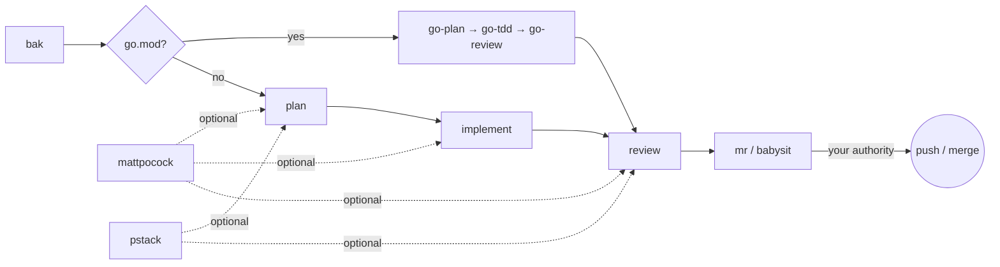

# 🦇 BAK — bad-agent-kit

> The skill router that keeps your agent from shipping the bad one. A curated
> skills marketplace + workflow orchestrator. **Compose, never own.**
>
> Never mutate on inspect. Never publish without authority.

[](https://www.npmjs.com/package/bad-agent-kit)
[](LICENSE)

## What is it

- **Marketplace** — pins and composes battle-tested upstream skills
  (mattpocock, pstack). Never vendors them.
- **Orchestrator** — the `bak` router drives plan → implement → review → mr
  through a self-contained builtin lane. Works with zero external suites.

## Install

```bash
# pi — everything builtin
pi install npm:bad-agent-kit

# Cursor / Claude Code / Codex (skills.sh) — the 5 builtin skills
npx skills@latest add aniqaqill/bad-agent-kit -g --skill bak --agent cursor -y
npx skills@latest add aniqaqill/bad-agent-kit -g --skill go-plan --agent cursor -y
npx skills@latest add aniqaqill/bad-agent-kit -g --skill go-tdd --agent cursor -y
npx skills@latest add aniqaqill/bad-agent-kit -g --skill go-review --agent cursor -y
npx skills@latest add aniqaqill/bad-agent-kit -g --skill babysit --agent cursor -y

# optional providers (opt-in)
bash scripts/bootstrap.sh cursor --providers mattpocock
```

> Pick ONE channel per agent per provider.

## The workflow

Start every task the same way:

```
<agent>, repo is <path>. Goal: <one sentence>. Run bak and follow its route.
Grant authority only when it asks.
```

`bak` drives five phases. What each phase must produce never changes — only
who executes it changes (a present provider or the builtin lane).

1. **orient** — read-only. `bak` reads the repo, applies the go.mod fence, and
   detects providers. Nothing mutates.
2. **plan** — a design naming every seam and acceptance condition. You approve
   the spec before code starts.
3. **implement** — test-first at the agreed seams. Local only; nothing is
   pushed.
4. **review** — standards and spec reported separately. Report only; no push,
   no merge.
5. **mr** — `babysit` drives the PR (conflicts → threads → CI). Push/merge/
   close only on your explicit "go".



**Go fence:** if the repo has a `go.mod`, Go work always uses the builtin
`go-plan`/`go-tdd`/`go-review` — never a provider.

## Providers (optional)

A provider runs only when pinned AND detected; otherwise `bak` falls back to
the builtin lane with a skip note.

| Provider | What it adds | Install |
|---|---|---|
| mattpocock | plan / implement / review stack | [catalog](docs/catalog.md) |
| pstack | plan / adversarial review + evidence discipline | [catalog](docs/catalog.md) |

Full catalog: [docs/catalog.md](docs/catalog.md).

## Plug in any suite

A provider is any suite that owns a workflow phase. To plug one in, add
exactly three data-only artifacts — no router changes:

| Artifact | File |
|---|---|
| **Pin** | one line in `manifest/providers.toml` |
| **Adapter** | `adapters/<id>.md` — maps namespaced skills to phase contracts |
| **Detection** | `detect_<id>()` in `scripts/detect-providers.sh` |

`bak` routes only by namespaced id (`mp:*`, `pstack:*`, `local:*`), never by
bare name or discovery order. The contract a suite must satisfy:
[skills/bak/references/contracts.md](skills/bak/references/contracts.md).

## Connect pstack

Two ways to connect pstack:

1. **Plugin channel (canonical)** — `/add-plugin pstack` (Cursor) or
   `/plugin install pstack@cursor-plugins`.
2. **Manual clone (fallback, never canonical)** — `git clone cursor/plugins`
   to a pinned location and record the root. No npx.

Full spec: `adapters/pstack.md`.

## Privacy & license

A CI gate fails the build on personal literals. MIT — skills listed here
remain property of their authors.

## Acknowledgments

mattpocock/skills · cursor/plugins — pstack ("a finding survives only when a
run proves it").
