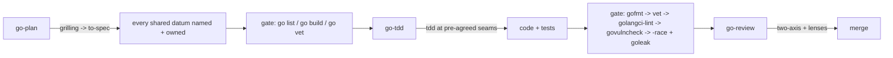
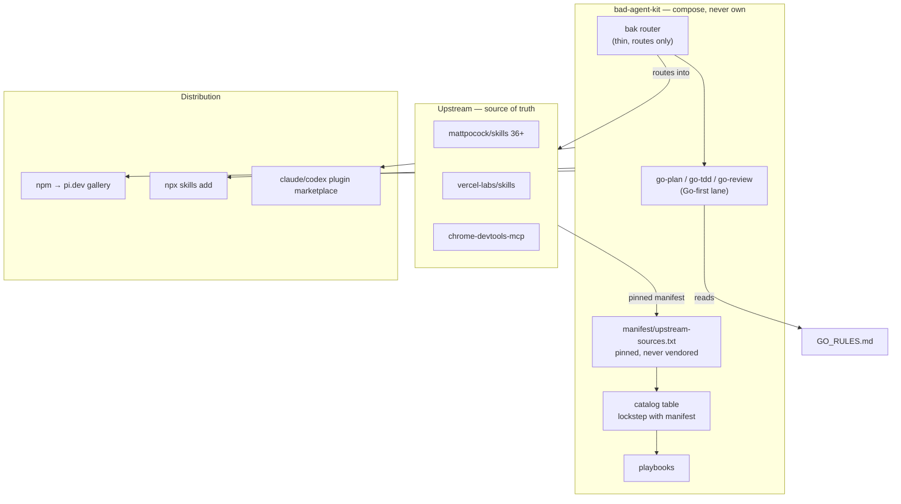

# 🦇 BAK — bad-agent-kit

> **BAK** (Bad-Agent Kit) — a curated skills marketplace + workflow
> orchestrator for coding agents. **Compose, never own.**
>
> *bad-agent-kit* is the persona: the punchline encodes the rules — don't ship
> the bad agent kit. Never mutate on inspect. Never publish without authority.
> Route every task through the smallest complete set of skills.

[](https://www.npmjs.com/package/bad-agent-kit)
[](https://pi.dev/packages)
[](https://skills.sh)
[](https://github.com/aniqaqill/bad-agent-kit/actions)
[](LICENSE)
[](CONTRIBUTING.md)

<sub>Tags: `golang` · `go` · `skills` · `marketplace` · `agent-skills` · `claude-code` · `codex` · `cursor` · `pi` · `mattpocock` · `pstack-inspired` · `workflow-orchestrator` · `tdd` · `code-review`</sub>

## Table of contents

- [What is this?](#what-is-this)
- [Install](#install)
- [The catalog](#the-catalog)
- [The BAK workflow](#the-bak-workflow)
- [Go-first skills](#go-first-skills)
- [Architecture](#architecture)
- [Repo layout](#repo-layout)
- [Contributing](#contributing)
- [Privacy & security](#privacy--security)
- [Acknowledgments](#acknowledgments)
- [License](#license)

## What is this?

Two things, one repo:

1. **Marketplace** — a curated catalog of battle-tested agent skills. The
   catalog below is the catalog of record: every entry pins a source, an
   install command, and its position in the BAK workflow. CI keeps the catalog
   in lockstep with the pinned manifest.
2. **Orchestrator** — the BAK router skill (`bak`) plus documented playbooks
   encoding how the skills chain together in real work: triage → spec →
   tickets → TDD → review → handoff, and a Go-first lane (plan → tdd →
   review) with sensor gates at every phase exit.

BAK never forks upstream. Skills stay owned by their authors; BAK pins them,
composes them, and documents the chains.

## Install

```bash
# pi
pi install npm:bad-agent-kit

# Claude Code / Codex / Cursor via skills.sh
npx skills@latest add aniqaqill/bad-agent-kit -g --skill bak --agent cursor -y
npx skills@latest add aniqaqill/bad-agent-kit -g --skill go-plan --agent cursor -y
npx skills@latest add aniqaqill/bad-agent-kit -g --skill go-tdd --agent cursor -y
npx skills@latest add aniqaqill/bad-agent-kit -g --skill go-review --agent cursor -y
```

> ⚠️ **Pick ONE channel per agent.** Installing through two channels on the
> same agent duplicates every skill and drifts hashes silently.

Bootstrap the full BAK stack for one agent (router + mattpocock suite +
discovery + browser):

```bash
bash scripts/bootstrap.sh cursor   # cursor | claude | codex
```

## The catalog

| Skill | Source | Install | Workflow position |
|---|---|---|---|
| `bak` | this repo | `pi install npm:bad-agent-kit` | router — start of every task |
| `go-plan` | this repo | `pi install npm:bad-agent-kit` | Go plan phase — grill then spec |
| `go-tdd` | this repo | `pi install npm:bad-agent-kit` | Go implement — sensor gates + e2e tests |
| `go-review` | this repo | `pi install npm:bad-agent-kit` | Go review — standards + spec lenses |
| `find-skills` | [vercel-labs/skills](https://github.com/vercel-labs/skills) | `npx skills@latest add vercel-labs/skills -g --skill find-skills --agent cursor -y` | discover new capabilities |
| `tdd` | [mattpocock/skills](https://github.com/mattpocock/skills) | `npx skills@latest add mattpocock/skills -g --skill tdd --agent cursor -y` | build/test-first |
| `triage` | [mattpocock/skills](https://github.com/mattpocock/skills) | `npx skills@latest add mattpocock/skills -g --skill triage --agent cursor -y` | issue intake |
| `to-spec` | [mattpocock/skills](https://github.com/mattpocock/skills) | `npx skills@latest add mattpocock/skills -g --skill to-spec --agent cursor -y` | synthesize plan |
| `to-tickets` | [mattpocock/skills](https://github.com/mattpocock/skills) | `npx skills@latest add mattpocock/skills -g --skill to-tickets --agent cursor -y` | split into tickets |
| `wayfinder` | [mattpocock/skills](https://github.com/mattpocock/skills) | `npx skills@latest add mattpocock/skills -g --skill wayfinder --agent cursor -y` | large/uncertain efforts |
| `request-refactor-plan` | [mattpocock/skills](https://github.com/mattpocock/skills) | `npx skills@latest add mattpocock/skills -g --skill request-refactor-plan --agent cursor -y` | planned refactors |
| `code-review` | [mattpocock/skills](https://github.com/mattpocock/skills) | `npx skills@latest add mattpocock/skills -g --skill code-review --agent cursor -y` | review before merge |
| `setup-matt-pocock-skills` | [mattpocock/skills](https://github.com/mattpocock/skills) | `npx skills@latest add mattpocock/skills -g --skill setup-matt-pocock-skills --agent cursor -y` | tracker setup |
| `grilling` | [mattpocock/skills](https://github.com/mattpocock/skills) | `npx skills@latest add mattpocock/skills -g --skill grilling --agent cursor -y` | stress-test ideas |
| `handoff` | [mattpocock/skills](https://github.com/mattpocock/skills) | `npx skills@latest add mattpocock/skills -g --skill handoff --agent cursor -y` | hand over work |
| `research` | [mattpocock/skills](https://github.com/mattpocock/skills) | `npx skills@latest add mattpocock/skills -g --skill research --agent cursor -y` | primary-source research |
| `codebase-design` | [mattpocock/skills](https://github.com/mattpocock/skills) | `npx skills@latest add mattpocock/skills -g --skill codebase-design --agent cursor -y` | deep-module design |
| `diagnosing-bugs` | [mattpocock/skills](https://github.com/mattpocock/skills) | `npx skills@latest add mattpocock/skills -g --skill diagnosing-bugs --agent cursor -y` | diagnosis loop |
| `domain-modeling` | [mattpocock/skills](https://github.com/mattpocock/skills) | `npx skills@latest add mattpocock/skills -g --skill domain-modeling --agent cursor -y` | GLOSSARY/ADRs |
| `improve-codebase-architecture` | [mattpocock/skills](https://github.com/mattpocock/skills) | `npx skills@latest add mattpocock/skills -g --skill improve-codebase-architecture --agent cursor -y` | architecture passes |
| `migrate-to-shoehorn` | [mattpocock/skills](https://github.com/mattpocock/skills) | `npx skills@latest add mattpocock/skills -g --skill migrate-to-shoehorn --agent cursor -y` | test type safety |
| `prototype` | [mattpocock/skills](https://github.com/mattpocock/skills) | `npx skills@latest add mattpocock/skills -g --skill prototype --agent cursor -y` | throwaway design probes |
| `resolving-merge-conflicts` | [mattpocock/skills](https://github.com/mattpocock/skills) | `npx skills@latest add mattpocock/skills -g --skill resolving-merge-conflicts --agent cursor -y` | merge/rebase conflicts |
| `scaffold-exercises` | [mattpocock/skills](https://github.com/mattpocock/skills) | `npx skills@latest add mattpocock/skills -g --skill scaffold-exercises --agent cursor -y` | course scaffolding |
| `grill-with-docs` | [mattpocock/skills](https://github.com/mattpocock/skills) | `npx skills@latest add mattpocock/skills -g --skill grill-with-docs --agent cursor -y` | grill with docs |
| `implement` | [mattpocock/skills](https://github.com/mattpocock/skills) | `npx skills@latest add mattpocock/skills -g --skill implement --agent cursor -y` | direct implementation |
| `grill-me` | [mattpocock/skills](https://github.com/mattpocock/skills) | `npx skills@latest add mattpocock/skills -g --skill grill-me --agent cursor -y` | get grilled |
| `qa` | [mattpocock/skills](https://github.com/mattpocock/skills) | `npx skills@latest add mattpocock/skills -g --skill qa --agent cursor -y` | issue filing |
| `teach` | [mattpocock/skills](https://github.com/mattpocock/skills) | `npx skills@latest add mattpocock/skills -g --skill teach --agent cursor -y` | teach a topic |
| `chrome-devtools` | [chromedevtools/chrome-devtools-mcp](https://github.com/ChromeDevTools/chrome-devtools-mcp) | `npx skills@latest add chromedevtools/chrome-devtools-mcp -g --agent cursor -y` | browser automation |

Full pinned manifest: [`manifest/upstream-sources.txt`](manifest/upstream-sources.txt).
Playbooks: [`docs/playbooks/`](docs/playbooks/).

## The BAK workflow


## Go-first skills

Go work gets first-principles treatment: mattpocock's conversation-first
phases + pstack's evidence discipline + Go's real sensors.

- **`go-plan`** — grills the design with the Go frontier taxonomy (goroutine
  ownership, channel-vs-mutex, leak prevention, error strategy, test seams)
  and synthesizes the spec. Human gate ON for concurrency decisions.
- **`go-tdd`** — implements test-first at pre-agreed seams. Fail-fast sensor
  chain at every phase exit: `gofmt -l` → `go vet` → `golangci-lint` →
  `govulncheck` → `go test -race` + `goleak`. Mandatory end-to-end
  expected-outcome tests.
- **`go-review`** — two-axis review with lenses: perf (goperf.dev, hot paths
  only), race (mandatory findings class), security (go.dev best practices),
  SOLID (Cheney's five words).

All rules live in one canonical contract —
[`skills/go-tdd/references/GO_RULES.md`](skills/go-tdd/references/GO_RULES.md):
24 sensor-tagged rules in HARD/REVIEW/EVIDENCE tiers. A finding survives only
when a run proves it.



## Architecture



## Repo layout

```text
skills/                BAK-owned skills (bak, go-plan, go-tdd, go-review)
manifest/              pinned upstream sources — never vendored
docs/playbooks/        how the skills chain in real work
docs/design-evidence.md  decision provenance ($HOME-scrubbed)
scripts/               bootstrap.sh / update.sh / scrub.sh / validate-catalog.js
.github/               CI: privacy-scrub gate + catalog lockstep + link check
```

## Contributing

Catalog edits follow the lockstep rule (manifest ↔ README, CI-enforced).
See [CONTRIBUTING.md](CONTRIBUTING.md).

## Privacy & security

A CI privacy-scrub gate fails the build on personal literals (home paths,
vault names, private endpoints). This repo ships only the portable core;
personal overlays stay local. See
[docs/design-evidence.md](docs/design-evidence.md).

## Acknowledgments

- [Matt Pocock's skills](https://github.com/mattpocock/skills) — the workflow
  stack BAK composes
- [cursor/plugins — pstack](https://github.com/cursor/plugins/tree/main/pstack) —
  the evidence discipline ("a finding survives only when a run proves it")
- [vercel-labs/skills](https://github.com/vercel-labs/skills) — find-skills
- [ChromeDevTools/chrome-devtools-mcp](https://github.com/ChromeDevTools/chrome-devtools-mcp) —
  browser automation
- [Effective Go](https://go.dev/doc/effective_go),
  [Cheney's SOLID-Go](https://dave.cheney.net/2016/08/20/solid-go-design),
  [goperf.dev](https://goperf.dev/), and
  [go.dev security best practices](https://go.dev/doc/security/best-practices) —
  the Go rulebook behind the go-* skills

## License

MIT — skills listed here remain property of their respective authors.
