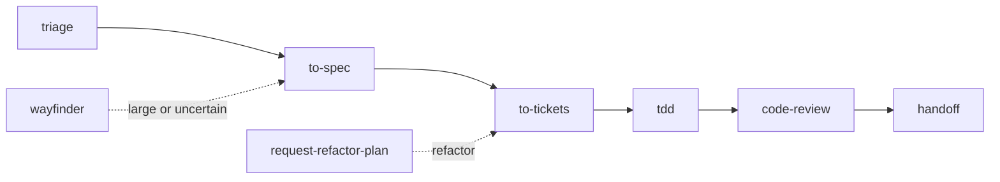

# Playbook: feature work (the BAK default chain)

The chain used for real feature work. Each step is an installed skill; `bak`
routes into the right entry point.

1. **triage** — intake the issue/request; confirm labels, tracker state, and
   confirmation steps before any Matt Pocock workflow.
2. **to-spec** — synthesize the plan; produce the spec document.
3. **to-tickets** — split the spec into executable tracer-bullet tickets.
4. **tdd** — implement each ticket test-first (red → green → refactor).
5. **code-review** — review the branch along standards + spec axes.
6. **handoff** — close the loop: summary, remaining risks, learning captured.

**Sensors throughout**: prehook.sh before material changes, posthook.sh after,
prepush.sh only immediately before a user-authorized push. Fast deterministic
checks first, broader checks proportional to risk.
