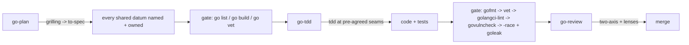

# Playbook: Go work (the go-* chain)

Go module work routes through the go-* family; bak stays the orchestrator.

1. **go-plan** — grill with the five frontier questions (ownership,
   channel-vs-mutex, leaks, error strategy, seam); synthesize the spec. Human
   gate ON for concurrency decisions. Exit: plan artifact names every shared
   datum and its owner; pre-flight `go list / go build / go vet`.
2. **go-tdd** — implement at pre-agreed seams via tdd; fail-fast sensor chain
   at every phase exit; mandatory end-to-end expected-outcome test (real
   binary against the real artifact).
3. **go-review** — two-axis review with the Go lenses (perf/race/security/
   solid); race findings are a mandatory class gated on `-race`; rules-rot
   upkeep at close.

Contract: `skills/go-tdd/references/GO_RULES.md` is shared between go-tdd and
go-review — never restate rules locally.
