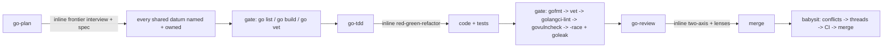

# Playbook: Go work (self-contained go-* chain)

Go module work is hard-fenced: `go.mod` ⇒ go-plan/go-tdd/go-review only.
The go-* skills are self-contained — no provider suite is ever required or
used for the Go lane.

1. **go-plan** — inline frontier interview (ownership, channel-vs-mutex,
   leaks, error strategy, seam); human gate ON for concurrency decisions.
   Exit: plan names every shared datum and its owner; pre-flight
   `go list / go build / go vet`.
2. **go-tdd** — inline red-green-refactor at pre-agreed seams; fail-fast
   sensor chain at every phase exit; mandatory end-to-end expected-outcome
   test (real binary against the real artifact).
3. **go-review** — inline two-axis review (Standards via GO_RULES.md +
   Effective Go + SOLID + security + goperf; Spec via originating issue);
   optional adversarial pass via pstack:interrogate when present; rules-rot
   upkeep at close.
4. **babysit** — MR loop: mode declared, merge frontier, conflicts → threads
   → CI, terminal state reported.

Contract: `skills/go-tdd/references/GO_RULES.md` is shared between go-tdd and
go-review — never restate rules locally.
